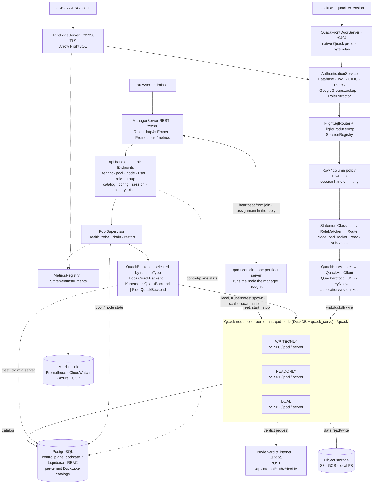

Quack on Demand is a gateway that puts a multi-tenant, access-controlled, horizontally-scaled SQL surface in front of DuckDB. Clients reach it over Arrow Flight SQL or DuckDB's native Quack protocol; either way the gateway authenticates them, authorizes each statement, and routes it to one of many DuckDB Quack nodes backed by shared DuckLake catalogs. This page is the conceptual overview; the pages it links to go deeper, and the [Architecture map](/qod/contributing/architecture-map) covers the codebase for contributors.

## The planes

The system separates a control plane from a data plane:

- **Control plane** - the manager process: a REST API and React admin UI for managing tenants, databases, pools, users, and access control, plus the supervisor that spawns and tracks nodes. Its state lives in the control-plane store (see [State storage](/qod/concepts/state-storage)).
- **Data plane** - the FlightSQL edge, the native Quack front door, and the Quack nodes behind them. This is where queries flow. The edge is stateless per request beyond the session it tracks; the nodes hold the DuckDB engines. Each node runs `qod-node`, QoD's own executable on the official DuckDB release library, which authorizes every statement before it runs.

Both run in a single uber-jar exposing four sockets: the manager REST + UI (`:20900`), the node verdict listener (`:20901`, the REST port plus one), the FlightSQL edge (`:31338`), and the native Quack front door (`:9494`, what a DuckDB client `ATTACH`es to). The Quack nodes listen on their own ports: child processes of the manager on the local runtime, pods on Kubernetes, and one node per joined server in a [fleet](/qod/operating/deploy-fleet).

## The object model

Three nested levels organize everything (see [Tenancy model](/qod/concepts/tenancy)):

- A **tenant** is the isolation boundary and selects its users' auth provider.
- A **tenant-db** is a database: a separate Postgres database holding a DuckLake catalog and a data path (see [DuckLake catalogs](/qod/concepts/catalogs)).
- A **pool** is a set of Quack nodes bound to one tenant-db, and is what clients connect to.

## The request lifecycle

When a client runs a statement, it passes through a fixed sequence:

1. **Authenticate.** The edge validates the connection's credential (database password, JWT, or OIDC) and resolves the target `(tenant, pool)`; the owning tenant-db is resolved server-side. See [Authenticating](/qod/connecting/authenticating).
2. **Rewrite.** For a principal holding row or column policies, the gateway rewrites the statement to filter rows and mask columns. See the [Access control model](/qod/operating/rbac-model).
3. **Classify and route.** The statement is classified read / write / DDL and dispatched to the least-loaded node whose role can serve it (on object-store pools, biased toward a node that already has its tables cached); an open transaction pins to its node. See [Routing](/qod/concepts/routing) and [Sessions and transactions](/qod/concepts/sessions-transactions).
4. **Authorize on the node.** The manager first installs a signed session handle naming the principal on the node connection. The node binds the statement, describes the plan (tables, views and columns, functions, settings, files) and, for a principal who is not a superuser, asks the manager replica that minted the handle for a verdict, cached on the node for 60 seconds. A refused statement never executes.
5. **Execute and stream.** The node runs the SQL against its DuckLake catalog and streams Arrow batches back through the edge to the client.

## Why this shape

- **DuckDB for compute, DuckLake for state.** Each node is a fast embedded engine; the durable catalog and Parquet data live in shared Postgres + object storage, so nodes are interchangeable and a pool can scale horizontally over one consistent view.
- **One endpoint, many nodes.** Clients see a single gateway, whichever wire they speak; it hides node placement, load balancing, transaction pinning, and failover-with-retry.
- **Two wires, one policy.** The FlightSQL edge and the native Quack front door share the same authentication, the same node-side authorization, the same router and the same audit log. The wire a client picks changes the driver, not the governance.
- **Access control on what DuckDB resolved.** Authentication happens once, at the edge; authorization happens in the node, on the bound plan, against grants the manager holds. Nothing a statement hides behind a view, a macro or a `query()` string escapes the check, and the same RBAC model covers native and federated tables alike.

## The pipeline in detail

**Two paths into Postgres.** The **manager** owns the control plane: it writes `qodstate_tenant` / `qodstate_tenant_db` / `qodstate_pool` / `qodstate_node` on tenant + pool CRUD, resolves the cached `EffectiveSet` for each authenticated session at handshake, and answers the nodes' verdict requests from it. Each **Quack node** owns the data plane against its tenant-db, reading and writing that DB's DuckLake `__ducklake_*` catalog tables directly. Two databases per tenant-db deployment (control-plane `qod` + tenant-db `${tenant}_${tenantDb}`) keep the control plane and DuckLake catalog cleanly separated while sharing one Postgres cluster.

## Where to go next

- Operators: start with [Deployment](/qod/operating/deploy-local) and [Tenants and databases](/qod/operating/tenants-databases).
- Client developers: [Connecting clients](/qod/connecting/clients).
- Contributors: the [Architecture map](/qod/contributing/architecture-map) and [Extending the manager](/qod/contributing/extending).
