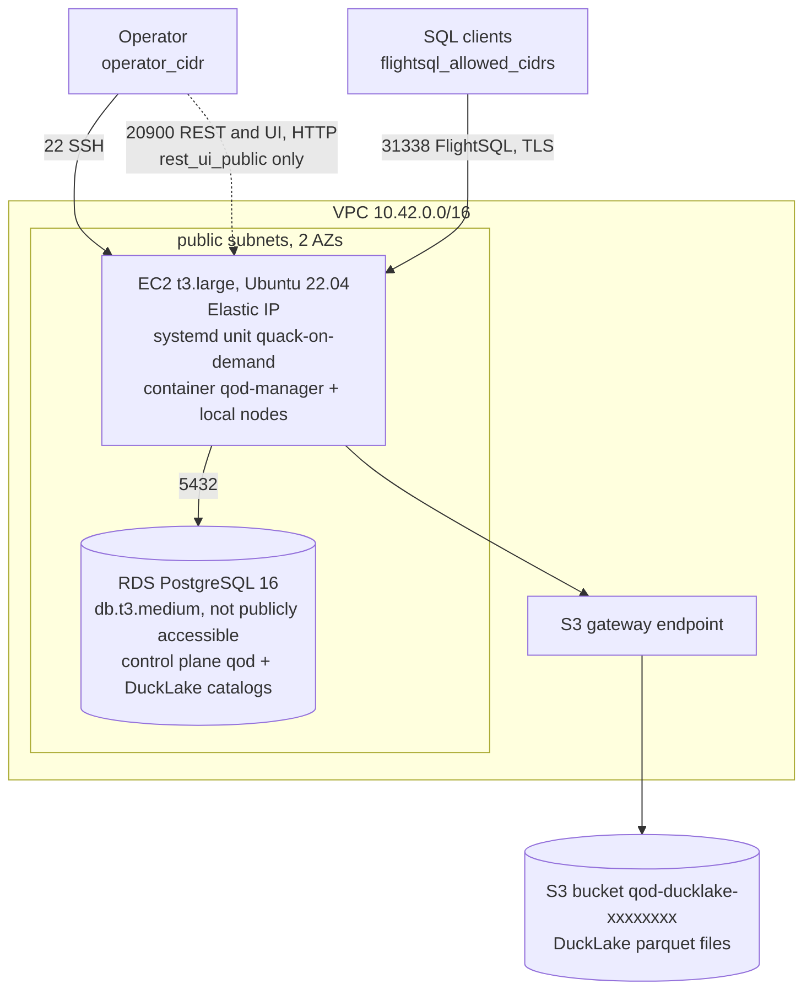
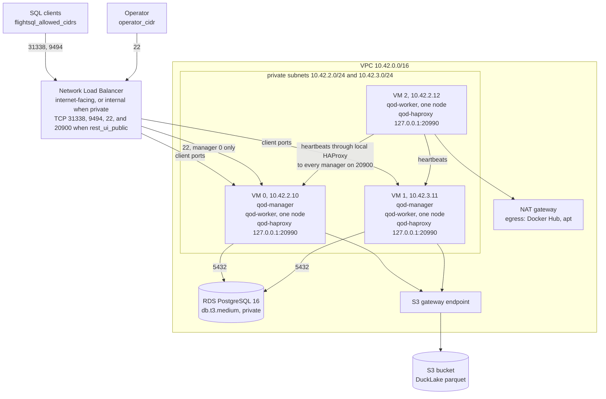

Audience: platform engineer who deploys on AWS with Terraform.
Scenario: one EC2 instance for a team or an evaluation, or a fleet of EC2 instances with two or more managers for high availability, each created with one `terraform apply`.

QoD runs on AWS in two shapes:

- **Single node**: one EC2 instance runs the manager, which spawns its DuckDB nodes as child processes inside its container (the local runtime).
- **Fleet**: `worker_count` EC2 instances each run a fleet worker (one DuckDB node), and the first `manager_count` of them also run a manager, behind a Network Load Balancer.

Both shapes run the Docker image `starlakeai/quack-on-demand` under systemd, on the host network. There is no Kubernetes and nothing is built on the instances. The Terraform lives in the [`starlake-ai/qod-deployment`](https://github.com/starlake-ai/qod-deployment/tree/main/terraform/aws) repository, folder `terraform/aws/`: `single-node/`, `fleet/`, and the shared `modules/`.

For the runtimes themselves, see [Single-server production deployment](./deploy-single-server.md) and [Fleet deployment](./deploy-fleet.md). This page covers what the AWS stacks create and how to run them.

## Architecture

### Single node

The default setup keeps the DuckLake data on S3, the catalog on RDS, and the instance on a public subnet with an Elastic IP.



Three variables pick the rest of the setup:

| Variable | Values (default first) | What it changes on AWS |
|---|---|---|
| `ducklake_storage` | `s3`, `local` | `s3`: a dedicated S3 bucket (public access blocked, AES256 encryption) and a scoped IAM user whose access key reaches the instance. `local`: no bucket; the parquet files go to an encrypted EBS volume (`gp3`, `data_volume_size_gb`, default 100) mounted at `/srv/qod-data`, under `/srv/qod-data/ducklake`. |
| `postgres_mode` | `managed`, `local` | `managed`: RDS PostgreSQL 16, database `qod`, generated master password, reachable only from the instance's security group. `local`: no RDS; a `postgres:16.16` container (`local_postgres_image`) runs as the `qod-postgres` systemd unit on `127.0.0.1:5432`, with its data on the EBS volume under `/srv/qod-data/postgres`. |
| `network_mode` | `public`, `private` | `public`: public subnet and an Elastic IP. `private`: the instance and RDS move to two private subnets, no public IP, egress through a NAT gateway (about USD 35 a month plus per-GB processing, per the stack's README). S3 traffic skips the NAT through the gateway endpoint in both modes. |

The EBS data volume exists as soon as either local mode is on. It is a separate resource from the instance, so it survives an instance replacement: cloud-init formats it as ext4 only when it carries no filesystem yet, and a new instance mounts the old data as is.

When the instance type has instance-store NVMe (`r6id.*`, `i4i.*`, `i3.*`, the `*d` types), cloud-init assembles the drives (RAID0 when there are several), mounts them at `/mnt/nvme` and uses them for DuckDB spill only. Without them, spill goes to the root disk. Instance store never holds DuckLake data or the catalog.

What gets created (`terraform/aws/single-node/main.tf`, about 26 resources with the defaults):

| Module | Resources and defaults |
|---|---|
| `network` | VPC `10.42.0.0/16` (`vpc_cidr`), 2 public subnets in 2 AZs (RDS needs two), internet gateway, route table, S3 gateway endpoint. `private` adds 2 private subnets, a NAT gateway and its Elastic IP. |
| `security` | Instance security group (22, 20900, 31338) and RDS security group (5432 from the instance security group only). |
| `rds` | `managed` only: `aws_db_instance` `qod-pg`, PostgreSQL 16, `db_instance_class` `db.t3.medium`, 20 GiB `gp3` (`db_allocated_storage`), encrypted, single AZ, master user `qodadmin` (`db_username`). |
| `s3` | `s3` only: bucket `qod-ducklake-<random hex>`, IAM user `qod-ducklake` with list/get/put/delete on that bucket, an access key. `s3_access_logging = true` adds a logs bucket. |
| `data-volume` | Either local mode: encrypted EBS volume, `gp3` (`data_volume_type`), 100 GiB (`data_volume_size_gb`, at least 10). |
| `instance` | EC2 `t3.large` (`instance_type`), latest Canonical Ubuntu 22.04 amd64 AMI, 30 GiB encrypted `gp3` root disk, key pair `qod-key`, the rendered cloud-init as user data. `public` adds the Elastic IP. |

The manager reads its settings from `/etc/quack-on-demand.env`. The DuckLake data path is `s3://<ducklake_bucket>/qod` with S3, or `/srv/qod-data/ducklake/qod` with `local`. On a GCP run of the same template layout, a database `acme_lake` created through the CLI landed in `/srv/qod-data/ducklake/acme_lake`, next to `qod`, not inside it. Expect the same on AWS (`s3://<ducklake_bucket>/acme_lake/` with S3); this has not been checked on AWS.

### Fleet



How it fits together (`terraform/aws/fleet/`):

- **Managers** run on VMs `0 .. manager_count-1` in the fleet runtime with HA on (`QOD_RUNTIME_TYPE=fleet`, `QOD_HA_ENABLED=true`). They share the control plane in RDS and elect a leader there; any manager serves any client. Nodes call each manager back on its own private address (`QOD_INTERNAL_URL=http://<vm ip>:20901`), never through the load balancer.
- **Workers** run on every VM, managers included: the image's `worker` role (`qod fleet join`), one node each, node port 21900. A worker heartbeats to `http://127.0.0.1:20990`, the local HAProxy, which health-checks every manager's `GET /health` on 20900 every 2 s and forwards to a live one. Losing a manager does not strand a worker.
- **Credentials**: a worker's env file, `/etc/qod/worker.env`, holds only the join token. The manager sends the PostgreSQL and S3 credentials with each node assignment. Joins are approved automatically only from the two private subnets (`QOD_FLEET_AUTO_APPROVE`).
- **Fixed addresses**: VM `i` is host `10 + i` of private subnet `i % 2` (`10.42.2.0/24` or `10.42.3.0/24` with the default `vpc_cidr`). Every VM's cloud-init therefore knows every manager's address before anything exists.
- **Load balancer**: one Network Load Balancer, TCP passthrough, cross-zone on. Listeners on 31338 and 9494 (and 20900 when `rest_ui_public = true`) forward to the manager VMs; their target groups health-check `GET /health` on 20900. A listener on 22 forwards to manager 0 only.
- **No public IPs** on any VM, in either network mode. `network_mode = "public"` makes the NLB internet-facing; `"private"` makes it internal.

| Variable | Default | Notes |
|---|---|---|
| `worker_count` | `3` | Fleet VMs; at least 2. Every VM runs a worker. |
| `manager_count` | `2` | At least 2, at most `worker_count` (checked at plan time). |
| `instance_type` | `m6i.xlarge` | Every VM, 4 vCPU and 16 GiB per the stack's README. Ubuntu 24.04 AMI, 30 GiB encrypted `gp3` root disk. |
| `db_instance_class` | `db.t3.medium` | About 400 connections; the managers and every node hold catalog connections. |
| `qod_version` | `0.14.2` | Exact versions only; `latest` is refused. |
| `haproxy_image` | `haproxy:3.0.31` | Exact versions only. |
| `duckdb_memory_fraction` | `0.5` | Node `memory_limit` as a fraction of VM RAM. |
| `admin_password` | none, required | At least 12 characters, not `admin`. The managers' preflight refuses default-like values. |
| `tls_mode` | `self-signed` | Or `provided`, with `tls_cert_pem` and `tls_key_pem` installed on every manager. |
| `maintenance_enabled` | `true` | QoD maintenance scheduler; `maintenance_min_interval_min` defaults to 30. |

The fleet stack always uses RDS and S3: it has no `ducklake_storage` or `postgres_mode` variable.

### Network and security

| Port | Service | Single node, `public` | Single node, `private` | Fleet |
|---|---|---|---|---|
| 31338 | FlightSQL edge, TLS | `flightsql_allowed_cidrs` (empty by default) | VPC CIDR + `private_access_cidrs` | NLB listener; VM security group admits `flightsql_allowed_cidrs` (empty by default) and the VPC CIDR |
| 9494 | DuckDB quack front door | not opened | not opened | NLB listener; same sources as 31338 |
| 20900 | REST API and admin UI, plain HTTP | `operator_cidr` when `rest_ui_public = true`, else closed (SSH tunnel) | VPC CIDR + `private_access_cidrs` | VPC CIDR (heartbeats, NLB health checks); `operator_cidr` through the NLB only when `rest_ui_public = true` |
| 22 | SSH | `operator_cidr` | VPC CIDR + `private_access_cidrs` | NLB port 22 to manager 0 from `operator_cidr`; VPC CIDR for `ssh -J` hops between VMs |
| 20901 | Manager internal URL (HA, node verdict calls) | not opened | not opened | VPC CIDR |
| 21900 | Fleet node port, manager to node | not opened | not opened | VPC CIDR |
| 5432 | PostgreSQL | RDS: from the instance security group only. Local: `127.0.0.1` only | same | RDS: from the fleet VM security group only |

In `network_mode = "public"` the single-node security group adds no rule for a port whose list is empty: with the defaults only SSH from `operator_cidr` is open. The REST API and admin UI are plain HTTP, so prefer the SSH tunnel to `rest_ui_public = true`.

**Where filtering happens.** The fleet NLB has no security group. With instance targets it preserves the client IP, so the source filtering happens on the VMs' security group (`qod-fleet-vm`), against the real client address. Inside the VPC every fleet port is open to the VPC CIDR, so in private mode any host in the VPC reaches 31338, 9494 and 20900 whatever `flightsql_allowed_cidrs` says.

**SSH path.** Single node: straight to the Elastic IP (`public`), or to `manager_private_ip` from a host that reaches the VPC (`private`). Fleet: `ssh ubuntu@<lb_address>` lands on manager 0; every other VM is one hop further, `ssh -J ubuntu@<lb_address> ubuntu@<private ip>`. The login user is `ubuntu`.

**Secrets.** Every secret lives in root-only (`0600`) env files on the instances: `/etc/quack-on-demand.env` on managers (PostgreSQL password, S3 access key, admin password, session secret, join token), `/etc/qod/worker.env` on every fleet VM (join token only), `/etc/qod-postgres.env` with a local PostgreSQL. Docker hands the values to the containers. The fleet stack has no secret outputs. The single-node stack echoes `admin_password` (your own tfvars value) as a sensitive output for scripts. Both stacks render the secrets into the instances' user data, so they also sit in the local `terraform.tfstate`: keep it out of git, or move it to an encrypted remote backend.

**Instance metadata.** Both stacks require IMDSv2 with a hop limit of 1, and cloud-init installs an nftables rule that drops TCP 80 to `169.254.169.254` for every non-root user. Containers run on the host network as uid 1000, so the rule keeps them, and the DuckDB nodes, away from the user data, which holds the database password and the S3 key.

Docker runs with `"iptables": false` and no bridge network, so it publishes nothing on its own. For the QoD-side controls, see [Hardening](./hardening.md) and [TLS](./tls.md).

## How to

### Prerequisites

- Terraform 1.5 or later for `single-node/`, 1.7 or later for `fleet/` (`terraform version`). The AWS provider is `hashicorp/aws ~> 5.0`.
- The AWS CLI, to check credentials, empty buckets and take snapshots. `jq` for the fleet loops below.
- AWS credentials from the environment, never in tfvars. Any one of:
  - `export AWS_ACCESS_KEY_ID=... AWS_SECRET_ACCESS_KEY=... AWS_REGION=eu-west-3`
  - a named or SSO profile: `export AWS_PROFILE=...`, or set `aws_profile` in `terraform.tfvars`
  - check with `aws sts get-caller-identity`
- Permission to create VPCs, EC2 instances, EBS volumes, Elastic IPs, NAT gateways, RDS instances, S3 buckets, IAM users and access keys, and (fleet) load balancers.
- Room in your EC2 vCPU quota for the instances: with the fleet defaults, 3 x `m6i.xlarge`.
- An SSH key pair. A dedicated one keeps the deployment apart from your personal keys:

```bash
ssh-keygen -t ed25519 -f ~/.ssh/qod-aws -N "" -C "qod-aws"
cat ~/.ssh/qod-aws.pub          # goes into ssh_public_key
curl -4 -s ifconfig.me ; echo   # your public IPv4: use it as <ip>/32 in operator_cidr
```

There is no API to enable on AWS. The default region is `eu-west-3`.

### Deploy a single node

1. Get the code and go to the stack:

   ```bash
   git clone https://github.com/starlake-ai/qod-deployment.git
   cd qod-deployment/terraform/aws/single-node
   cp terraform.tfvars.example terraform.tfvars
   ```

2. Edit `terraform.tfvars`. `operator_cidr`, `ssh_public_key` and `admin_password` are required. `admin_password` needs at least 12 characters and no default-like value: Terraform rejects it at plan, and the instance's preflight refuses it at boot. `qod_version` defaults to `0.14.2`.

   ```hcl
   region         = "eu-west-3"
   operator_cidr  = "203.0.113.10/32"            # your IPv4 /32: SSH in public mode
   ssh_public_key = "ssh-ed25519 AAAA... qod-aws"
   admin_password = "change-me-to-a-real-passphrase"   # 12+ characters, required

   flightsql_allowed_cidrs = ["203.0.113.10/32"] # FlightSQL is closed until you list ranges
   # rest_ui_public        = true                # REST/UI to operator_cidr; default: SSH tunnel only

   # Setup options (defaults shown):
   # ducklake_storage = "s3"        # or "local": EBS volume at /srv/qod-data
   # postgres_mode    = "managed"   # or "local": PostgreSQL container on 127.0.0.1
   # network_mode     = "public"    # or "private": no public IP, NAT egress
   # private_access_cidrs = []      # private mode: VPN or peered ranges (the VPC is always allowed)
   # data_volume_size_gb  = 100     # created when either local mode is on
   ```

   `operator_cidr` is required even in private mode, where it is not used. `terraform.tfvars` is gitignored.

3. Create the stack. RDS takes most of the time, about 5 to 10 minutes.

   ```bash
   terraform init
   terraform plan      # about 26 resources with the defaults
   terraform apply
   ```

4. Wait for cloud-init. The instance answers SSH before the bootstrap is done: Docker and the PostgreSQL client install, the data volume is formatted and mounted when a local mode needs it, then systemd pulls the image (about 1 GB) and starts it.

   ```bash
   IP=$(terraform output -raw manager_public_ip)    # private mode: manager_private_ip, from inside the VPC
   ssh -i ~/.ssh/qod-aws ubuntu@"$IP" 'sudo cloud-init status --wait'
   ```

5. Check the service:

   ```bash
   ssh -i ~/.ssh/qod-aws ubuntu@"$IP" 'sudo systemctl is-active quack-on-demand'          # active
   ssh -i ~/.ssh/qod-aws ubuntu@"$IP" 'curl -s http://127.0.0.1:20900/health; echo'
   ssh -i ~/.ssh/qod-aws ubuntu@"$IP" 'curl -s http://127.0.0.1:20900/ready; echo'
   ```

   With `postgres_mode = "local"`, also check `sudo systemctl is-active qod-postgres`. The image has no curl: run health checks on the host, as above.

6. Continue with [First use](#first-use). The endpoints are outputs:

   | Output | Meaning |
   |---|---|
   | `setup` | The three setup options, as applied |
   | `manager_public_ip` | Elastic IP; `null` in private mode |
   | `manager_private_ip` | VPC address; the client address in private mode |
   | `rest_ui_url` | `http://<ip>:20900`, REST and UI, plain HTTP |
   | `flightsql_endpoint` | `<ip>:31338`, FlightSQL, TLS |
   | `rds_host` | RDS endpoint; `null` with a local PostgreSQL |
   | `ducklake_bucket` | S3 bucket; `null` with local storage |
   | `data_volume_id` | EBS data volume; `null` when neither local mode is on |
   | `admin_password` | Sensitive: your tfvars value, echoed for scripts |

   The Elastic IP survives instance stop, start and replacement; only `terraform destroy` releases it. In private mode the private IP changes when the instance is replaced.

### Deploy a fleet

1. Go to the stack and write the tfvars:

   ```bash
   cd qod-deployment/terraform/aws/fleet
   cp terraform.tfvars.example terraform.tfvars
   ```

   ```hcl
   operator_cidr  = "203.0.113.4/32"              # SSH through the NLB to manager 0
   ssh_public_key = "ssh-ed25519 AAAA... qod-aws"
   admin_password = "change-me-to-a-real-passphrase"   # 12+ characters, required

   # Who reaches FlightSQL (31338) and DuckDB quack (9494). Empty = nobody.
   flightsql_allowed_cidrs = ["203.0.113.4/32"]

   # worker_count   = 3              # fleet VMs, each runs a worker
   # manager_count  = 2              # >= 2 and <= worker_count
   # instance_type  = "m6i.xlarge"
   # network_mode   = "public"       # or "private": internal NLB
   # rest_ui_public = false          # true: NLB port 20900 open to operator_cidr
   # qod_version    = "0.14.2"       # exact versions only
   ```

2. Create the stack:

   ```bash
   terraform init
   terraform apply
   ```

3. Wait for every VM through the SSH path. `ssh -J` does not pass `-i` to the jump host, so load the key into your agent first. In private mode the NLB is internal: run this from a host inside the VPC or behind a VPN or peering.

   ```bash
   ssh-add ~/.ssh/qod-aws
   LB=$(terraform output -raw lb_address)
   ssh ubuntu@"$LB" 'sudo cloud-init status --wait && systemctl is-active quack-on-demand qod-worker qod-haproxy'
   for ip in $(terraform output -json worker_ips | jq -r '.[]'); do
     ssh -J ubuntu@"$LB" ubuntu@"$ip" 'sudo cloud-init status --wait; systemctl is-active qod-worker qod-haproxy'
   done
   ```

   The first command lands on manager 0; `worker_ips` lists every VM, manager 0 included.

4. Check the fleet from manager 0, with the CLI inside the manager container. Log in as `admin` with `admin_password`:

   ```bash
   ssh -t ubuntu@"$LB" 'sudo docker exec -it qod-manager qod login --url http://127.0.0.1:20900'
   ssh -t ubuntu@"$LB" 'sudo docker exec -it qod-manager qod fleet servers'
   ```

   Every VM should be listed as reachable and approved. To use the CLI or the admin UI from your workstation instead, open the tunnel that the `rest_ui` output prints (`ssh -N -L 20900:localhost:20900 ubuntu@<lb_address>`, then `http://localhost:20900`), or set `rest_ui_public = true`.

5. Continue with [First use](#first-use), against a manager. The outputs:

   | Output | Meaning |
   |---|---|
   | `setup` | `network_mode`, `worker_count`, `manager_count` |
   | `lb_address` | NLB DNS name, the one address clients use |
   | `lb_internal`, `lb_client_ports` | Whether the NLB is internal; its client ports |
   | `flightsql_endpoint` | `<lb_address>:31338`, TLS |
   | `duckdb_endpoint` | `quack:<lb_address>`, port 9494 |
   | `rest_ui` | The NLB URL when `rest_ui_public`, else the SSH tunnel command |
   | `ssh_manager0` | `ssh ubuntu@<lb_address>` |
   | `manager_ips`, `worker_ips` | Private IPs, in VM order |
   | `pg_host`, `pg_port`, `ducklake_bucket` | RDS endpoint and S3 bucket |

### First use

A fresh install has no tenant. Until a tenant, a database and a pool exist, FlightSQL refuses connections with `missing tenant scope ... 'tenant' header required`. Create them with the CLI inside the manager container, which runs the same QoD version as the server. Log in as `admin` (or `admin@localhost.local`) with `admin_password`.

On the single node, SSH to the instance first; on the fleet, SSH to manager 0 (`ssh ubuntu@<lb_address>`).

```bash
sudo docker exec -it qod-manager qod login --url http://127.0.0.1:20900          # user admin, password = admin_password
sudo docker exec -it qod-manager qod tenant create acme --display-name Acme
sudo docker exec -it qod-manager qod database create --tenant acme --name lake   # creates database acme_lake
sudo docker exec -it qod-manager qod pool create --tenant acme --db acme_lake --pool bi --size 1 --dual 1
```

`--display-name` is required on `tenant create` in 0.14.2. Then query from your workstation over FlightSQL (TLS, self-signed by default). `qod login` needs the REST port:

```bash
# single node, public mode with rest_ui_public = true
qod login --url "$(terraform output -raw rest_ui_url)"
# single node, otherwise: tunnel both ports first
#   ssh -i ~/.ssh/qod-aws -f -N -L 20900:localhost:20900 -L 31338:localhost:31338 ubuntu@"$IP"
#   qod login --url http://localhost:20900
# fleet: through the tunnel from the rest_ui output, or the NLB with rest_ui_public = true
qod login --url http://localhost:20900

qod sql --tenant acme --pool bi --superuser "SELECT 42"
```

`qod sql` prompts for the SQL password, or reads `QOD_PASSWORD`. `qod login` stores the FlightSQL edge settings the manager reports. Behind the fleet tunnel, point the CLI at the load balancer with `QOD_HOST=$(terraform output -raw lb_address)` if it does not reach the edge; this has not been tested on AWS.

The admin credentials are for setup. For automation, create a personal access token with `qod auth pat create` (see the [CLI reference](../cli/reference.md)). For client settings (JDBC, ADBC, BI tools, the `tenant`, `pool` and `superuser` parameters), see [Authenticating](../connecting/authenticating.md) and [Clients](../connecting/clients.md). The admin UI generates ready connection strings on each pool's "Client connection" tab.

### Operate

**Logs.** The containers log to the journal by container name; the systemd units log under their own names. Run these on the instance (single node) or on the VM in question (fleet):

```bash
sudo journalctl CONTAINER_NAME=qod-manager -f
```

```bash
sudo journalctl -u quack-on-demand --no-pager | tail -40
```

On fleet VMs, also `sudo journalctl CONTAINER_NAME=qod-worker -f`, `sudo journalctl CONTAINER_NAME=qod-haproxy -f` and `sudo journalctl -u qod-worker`. On a single node with a local PostgreSQL, `sudo systemctl status qod-postgres`.

**Upgrade in place, single node.** Edit the version in the env file and restart; the unit pulls the new tag once:

```bash
sudo sed -i 's/^QOD_VERSION=.*/QOD_VERSION=<new>/' /etc/quack-on-demand.env
sudo systemctl restart quack-on-demand
```

**Upgrade in place, fleet.** One VM at a time, managers one after the other so one always stays up: set `QOD_VERSION=<new>` in `/etc/qod/worker.env` and, on managers, in `/etc/quack-on-demand.env`, then `sudo systemctl restart qod-worker` (and `sudo systemctl restart quack-on-demand` on managers).

In both stacks, set the same `qod_version` in `terraform.tfvars` afterwards. Changing `qod_version` in Terraform changes the user data, and any user data change replaces the instance (`user_data_replace_on_change`): on the fleet, every VM at once. Read the [upgrade notes](./upgrading.md) before a version jump.

**Rebuild.** Changing `qod_version`, `ssh_public_key` or the cloud-init template replaces the instance on the next `apply`. To rebuild on purpose:

```bash
terraform apply -replace=module.instance.aws_instance.manager      # single node
terraform apply -replace='module.vms.aws_instance.vm[2]'           # fleet, VM 2
```

On a single node, the Elastic IP and the EBS data volume stay. The first-boot marker lives on the data volume when there is one, so a replacement does not re-run the first-boot seeding. A fleet VM keeps its fixed private IP. Rebuilding manager 0 cuts the SSH path until it is back.

**Scale the fleet.** Raise `worker_count` and apply: the new VMs boot, join through their HAProxy and get nodes. Lowering it destroys the highest-numbered VMs without draining them: their nodes are reassigned after the fleet heartbeat timeout and the sessions on them fail. Drain a server first with `qod fleet drain` if that matters. Changing `manager_count` changes every VM's HAProxy backend list, so every VM is replaced: plan it as a full restart.

**Back up local data, single node.** In the local modes nothing backs up the EBS volume. Snapshot it:

```bash
aws ec2 create-snapshot --volume-id "$(terraform output -raw data_volume_id)"
```

With RDS, `db_skip_final_snapshot` defaults to `true`; set it to `false` to keep a final snapshot at destroy.

### Tear down

Neither stack enables deletion protection on RDS or the load balancer. Before `terraform destroy`:

1. Empty the S3 bucket. It is not `force_destroy`, and the destroy stops on `BucketNotEmpty` otherwise. With `s3_access_logging = true`, empty the logs bucket too.

   ```bash
   aws s3 rm "s3://$(terraform output -raw ducklake_bucket)" --recursive
   ```

2. Snapshot what you want to keep. RDS is dropped with no final snapshot by default (`db_skip_final_snapshot = true`). On a single node, the EBS data volume (local DuckLake data, local PostgreSQL) is destroyed with no snapshot.

3. Destroy:

   ```bash
   terraform destroy
   ```

### Status

What has been validated on AWS, as of 2026-11-25:

| Item | Single node | Fleet |
|---|---|---|
| `terraform test` against mock providers | 9 runs: default setup, closed FlightSQL and REST by default, allow-lists open only the listed ranges, IMDSv2 required, default admin password refused, local modes drop RDS and the bucket, private mode uses the private subnet, the removed `nvme` storage value and the old run-jar version modes are refused | 9 runs: topology, network modes, listeners, plan-time guards |
| cloud-init render checks | s3/managed and local/local renders pass `bash -n`; the preflight refuses `admin` | manager and worker-only renders pass `bash -n` and shellcheck |
| Real `terraform apply` of the current stack | not run | not run |
| NLB health checks, joins through HAProxy, HA failover between managers | n/a | not proven |
| IMDS lockdown (Ubuntu 22.04 single node, 24.04 fleet) | not proven | not proven |
| First-use sequence above | checked on a GCP single node with QoD 0.14.2, not on AWS | not run |
| Data path of a new database | not checked on AWS | not checked |

Treat both stacks as unverified on AWS until a real apply has been run end to end.
