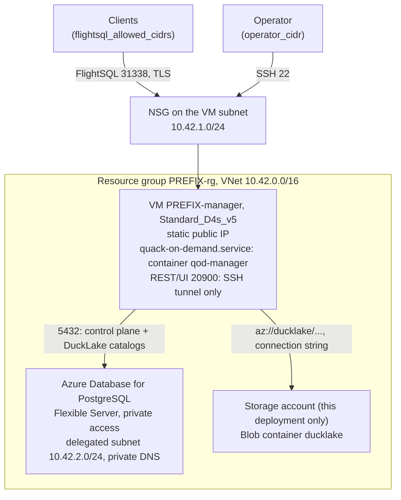
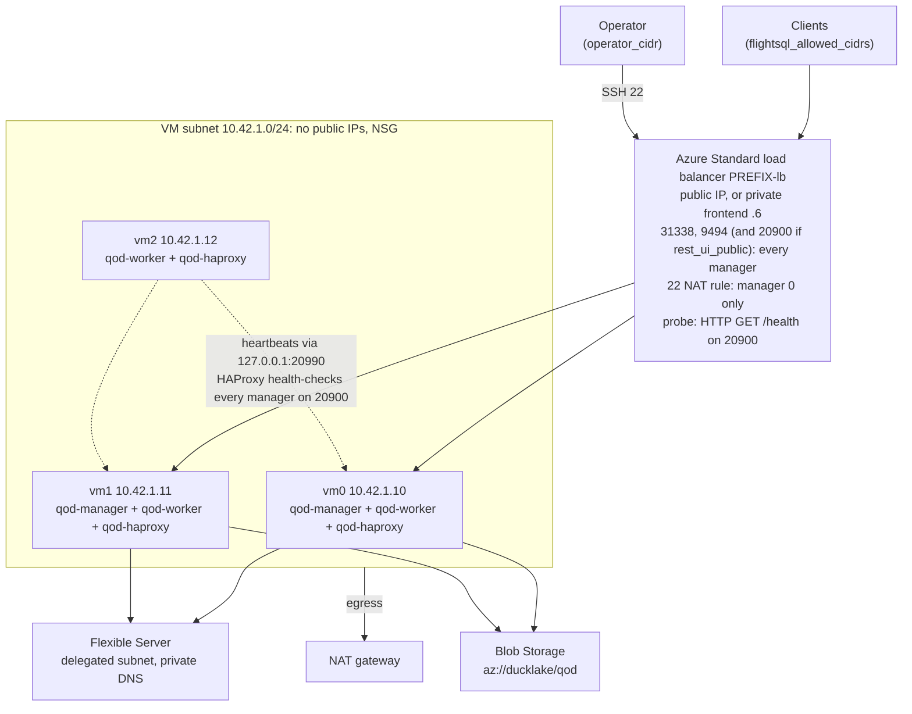

Audience: platform engineer who deploys on Microsoft Azure and wants QoD running from one `terraform apply`.
Scenario: either one Azure VM (the single node), or several VMs that each run a quack node, with two or more of them also running a manager behind an Azure Standard load balancer (the fleet).

Both shapes run the pinned `starlakeai/quack-on-demand` Docker image under systemd, on the host network of Ubuntu 24.04 VMs. There is no Kubernetes. One `terraform apply` creates the network, the catalog database, the object storage and the VMs, and cloud-init starts QoD on first boot.

The Terraform lives in the [`starlake-ai/qod-deployment`](https://github.com/starlake-ai/qod-deployment/tree/main/terraform/azure) repository, folder `terraform/azure/`:

| Folder | What it is |
|---|---|
| `single-node/` | The single node stack (run Terraform here) |
| `fleet/` | The fleet stack (run Terraform here) |
| `modules/` | `network`, `postgres`, `storage`, `instance` (shared), `fleet-vm` and `fleet-lb` (fleet only) |

For what the fleet runtime does inside QoD (joining, approval, scheduling), see [Fleet deployment](./deploy-fleet.md). For the same layout without Terraform, see [Single-server production deployment](./deploy-single-server.md).

## Architecture

### Single node

The default setup is `ducklake_storage = "s3"`, `postgres_mode = "managed"`, `network_mode = "public"`:



With the default setup the VM holds no durable state: the catalog is in Flexible Server and the data is in the Blob container. Local NVMe or the temp disk on the VM is DuckDB spill only.

Three variables shape the stack:

| Variable | Value | What it changes on Azure |
|---|---|---|
| `ducklake_storage` | `s3` (default) | DuckLake data in Azure Blob Storage: a storage account dedicated to this deployment, container `ducklake`, default data path `az://ducklake/qod`. QoD authenticates with the account connection string (`QOD_AZURE_CONNECTION_STRING`). The value keeps the name `s3` shared with the other clouds; Azure is reached through `az://`, not the S3 API. |
| | `local` | No storage account. A persistent managed disk (`data_volume_size_gb`, default 100 GB, type `data_volume_type`, default `Premium_LRS`) is attached at LUN 0, formatted ext4 only when empty, and mounted at `/srv/qod-data`. Data lands under `/srv/qod-data/ducklake/`. |
| `postgres_mode` | `managed` (default) | Azure Database for PostgreSQL Flexible Server in a subnet delegated to `Microsoft.DBforPostgreSQL/flexibleServers`, no public endpoint, resolved through the private DNS zone `<prefix>.private.postgres.database.azure.com`. |
| | `local` | No Flexible Server and no delegated subnet. A `postgres:16.16` container (unit `qod-postgres`) listens on 127.0.0.1:5432 only, with its data on the same persistent disk under `/srv/qod-data/postgres`. |
| `network_mode` | `public` (default) | The VM gets a static Standard public IP, which is also its only egress. |
| | `private` | No public IP. Egress goes through a NAT gateway with its own static public IP. You reach the VM from the VNet, a VPN or a bastion, and `operator_cidr` and `flightsql_allowed_cidrs` must be ranges that reach the VNet. |

Either local mode creates the data disk. It is a resource of its own, so it survives a VM replacement and is reattached as is. `terraform destroy` deletes it.

What `single-node/` creates (defaults in parentheses):

| Resource | Details |
|---|---|
| Resource group | `<prefix>-rg` (`name_prefix = "qod"`), in `location` (`westeurope`). It holds every resource of the stack. |
| VNet and subnets | `<prefix>-vnet` (`vnet_cidr = "10.42.0.0/16"`). VM subnet: the /24 number 1 (`10.42.1.0/24`), Azure default outbound access off. PostgreSQL subnet: the /24 number 2 (`10.42.2.0/24`), managed mode only. |
| NSG | `<prefix>-vm-nsg`, associated with the VM subnet. See [Network and security](#network-and-security). |
| VM | `<prefix>-manager`, `vm_size = "Standard_D4s_v5"` (4 vCPU, 16 GB, no temp or NVMe disk, so spill falls back to the OS disk), Ubuntu 24.04 LTS, OS disk 30 GB `Premium_LRS`, login user `ubuntu`, SSH key only. |
| Flexible Server | `<prefix>-pg-<random>`, PostgreSQL `db_version = "16"`, `db_sku = "B_Standard_B1ms"` (about 50 connections), `db_storage_mb = 32768`, administrator `qodadmin`, database `qod`. |
| Storage account | Name built from the prefix and a random suffix, StorageV2, Standard, LRS, TLS 1.2 minimum, HTTPS only, no public blobs. Container `ducklake`, private. |
| Data disk | `<prefix>-data`, local modes only. |
| NAT gateway | `<prefix>-nat` with public IP `<prefix>-nat-ip`, private mode only. |

QoD connects to Flexible Server as the administrator `qodadmin`, a member of `azure_pg_admin` with CREATEDB (QoD creates one database per tenant database) but not SUPERUSER. The `postgres` maintenance database exists on every Flexible Server, so no extra step is needed.

`B_Standard_B1ms` is enough for evaluation. Move to `B_Standard_B2s` or a General Purpose SKU when several pools or nodes run. For analytics, pick a VM size with local NVMe (`Standard_L*s_v3`) or a temp disk (`Standard_D*ds_v5`): cloud-init uses local NVMe first (RAID 0 when there are several, at `/mnt/nvme`), then the temp disk at `/mnt`, then the OS disk.

### Fleet



The fleet stack creates `worker_count` VMs. Every VM runs a QoD fleet worker (one quack node) and a local HAProxy. The first `manager_count` VMs also run a QoD manager. The managers are active-active, with a leader elected through PostgreSQL (`QOD_HA_ENABLED=true`, `QOD_RUNTIME_TYPE=fleet`). The fleet always uses Flexible Server and Blob Storage: it has no `ducklake_storage` or `postgres_mode` variable.

| Variable | Default | Meaning |
|---|---|---|
| `worker_count` | `3` | VMs, each with a worker (2 to 200) |
| `manager_count` | `2` | Managers on VMs `0 .. manager_count-1`: at least 2, at most `worker_count` |
| `network_mode` | `public` | `public`: the load balancer has a static public IP. `private`: a private frontend at host `.6` of the VM subnet. The VMs never have public IPs in either mode. |
| `vm_size` | `Standard_D4s_v5` | Size of every VM |
| `db_sku` | `B_Standard_B2s` | Flexible Server SKU (2 vCores, 4 GB, about 429 connections) |
| `rest_ui_public` | `false` | Also balance 20900 on the load balancer, open to `operator_cidr` |
| `duckdb_memory_fraction` | `0.5` | Share of each VM's RAM for its quack node (0.6 on the single node) |
| `qod_version` | `0.14.2` | QoD image tag, exact versions only |
| `haproxy_image` | `haproxy:3.0.31` | Heartbeat proxy image, exact versions only |
| `name_prefix` | `qodfleet` | Resource group `<prefix>-rg`, VMs `<prefix>-vm<i>` |

How the pieces fit:

- **Load balancer.** Standard SKU, layer 4. The rules `flightsql` (31338) and `duckdb` (9494), plus `rest` (20900) when `rest_ui_public`, send traffic to the backend pool `managers`. Each rule has a 30-minute idle timeout (FlightSQL sessions are long-lived gRPC streams), TCP reset on, and outbound SNAT off. The probe `manager-health` sends `GET /health` to port 20900 every 5 seconds and takes a manager out after 2 failures.
- **Heartbeats.** `qod fleet join` talks to one manager URL. Each VM's worker uses `http://127.0.0.1:20990`, where HAProxy (TCP mode, round robin) forwards to every manager's 20900 and checks `/health` every 2 seconds. The worker survives the loss of a manager.
- **Credentials on workers.** `/etc/qod/worker.env` holds only the join token, the image tag, the worker's name (`<prefix>-w<i>`), its advertised address and node port 21900. It has no PostgreSQL or storage credential: the manager sends the catalog and Blob Storage settings in each node assignment.
- **Verdict callbacks.** Each manager sets `QOD_INTERNAL_URL=http://<its VM ip>:20901`. Nodes call that address back for their statements' verdicts, never the load balancer.
- **Join approval.** `QOD_FLEET_AUTO_APPROVE` is the VM subnet CIDR: servers from the fleet's own subnet are approved on join, nothing else.
- **Deterministic addresses.** VM `i` gets the static address host `10 + i` of the VM subnet (`10.42.1.10`, `10.42.1.11`, ...). Terraform renders these addresses into every VM's cloud-init, which is why `worker_count` is capped at 200.

### Network and security

The NSG on the VM subnet is the packet filter. Azure's default rules still allow VNet-internal traffic (`AllowVnetInBound`) and load balancer probes (`AllowAzureLoadBalancerInBound`), and deny everything else inbound. The stack adds only the rules below for traffic from outside the VNet.

| Port | What | Single node | Fleet |
|---|---|---|---|
| 31338 | FlightSQL edge (TLS) | NSG: one rule per entry of `flightsql_allowed_cidrs`. Empty by default, so closed. | Load balancer rule to every manager; NSG: `flightsql_allowed_cidrs`. |
| 9494 | DuckDB `quack:` front door | No NSG rule: reachable from inside the VNet only. | Load balancer rule to every manager; NSG: `flightsql_allowed_cidrs`. |
| 20900 | REST API and admin UI | Closed. Opened to `operator_cidr` when `rest_ui_public = true`. Otherwise use an SSH tunnel. | Not on the load balancer unless `rest_ui_public = true` (then open to `operator_cidr`). Inside the VNet: HAProxy and the load balancer probe. |
| 22 | SSH | NSG: `operator_cidr`, straight to the VM. | Load balancer NAT rule `ssh-manager0`: port 22 to manager 0 only; NSG: `operator_cidr`. Other VMs: `ssh -J` through manager 0. |
| 20901 | HA and verdict listener (`QOD_INTERNAL_URL`) | Not used from outside. | VNet only: nodes call their manager back. |
| 21900 | Fleet node port | Not used. | VNet only: managers reach each worker's node. |
| 20990 | Local HAProxy | Not used. | 127.0.0.1 only. |
| 5432 | PostgreSQL | Flexible Server: private access in the delegated subnet, no public endpoint. Local mode: 127.0.0.1 only. | Flexible Server, private access. |

Source filtering happens in the NSG on both shapes. The fleet's Standard load balancer passes the client's source IP through to the VMs, so the same NSG rules filter clients that come through it. Traffic from inside the VNet is allowed by `AllowVnetInBound` whatever the allow-lists say: in `network_mode = "private"` the allow-lists matter only for sources the VNet sees as external.

Other protections the stacks apply:

- **Secrets stay off Terraform outputs.** The admin password, the storage connection string, the PostgreSQL password and the fleet join token are in root-only files (mode 600): `/etc/quack-on-demand.env` on the single node and on each manager, `/etc/qod/worker.env` on each fleet VM, `/etc/qod-postgres.env` in local PostgreSQL mode. They are also in the Terraform state: keep the state private.
- **Instance metadata lockdown.** Azure's instance metadata service at 169.254.169.254 answers any local process. It does not serve custom data, but it serves instance details and, if a managed identity is ever attached, access tokens. An nftables rule drops traffic to 169.254.169.254 from every non-root uid. QoD containers run as uid 1000 on the host network, so the rule covers them; the Azure agent and cloud-init run as root.
- **Docker cannot bypass the filter.** The Docker daemon runs with `"bridge": "none"` and `"iptables": false`, so every container uses the host network and Docker writes no NAT rules.
- **Default credentials refused.** A preflight step fails the unit when the admin password is missing, shorter than 12 characters or default-like. Terraform already refuses such an `admin_password` at plan time.
- **TLS.** `tls_mode = "self-signed"` (default) lets QoD generate a certificate at boot; clients skip verification. On the fleet each manager generates its own. `tls_mode = "provided"` installs `tls_cert_pem` and `tls_key_pem` (on every manager for the fleet; the certificate must name the load balancer address). See [TLS](./tls.md).

For QoD's own hardening (node enforcement, local files, init SQL), see [Hardening](./hardening.md).

## How to

### Prerequisites

- Terraform 1.7 or newer (`required_version = ">= 1.7"`, provider `hashicorp/azurerm ~> 4.0`).
- The Azure CLI (`az`), and `jq` for the fleet commands below.
- The `qod` CLI on your workstation, at the server's version: `uv tool install qod==0.14.2`.
- An SSH key pair. The public key goes in `ssh_public_key`.

Credentials come from the environment, never from tfvars. Either sign in with `az login`, or use a service principal through `ARM_CLIENT_ID`, `ARM_CLIENT_SECRET` and `ARM_TENANT_ID`. In both cases set `ARM_SUBSCRIPTION_ID`, which azurerm 4.x requires:

```bash
az login
export ARM_SUBSCRIPTION_ID=$(az account show --query id -o tsv)
```

Quotas: the default single node needs 4 vCPUs of the DSv5 family in the region, the default fleet 12 (three `Standard_D4s_v5`). Check your regional vCPU quota before applying, especially for L-series sizes. The stacks do not check quotas.

### Deploy a single node

1. Get the code.

   ```bash
   git clone https://github.com/starlake-ai/qod-deployment.git
   cd qod-deployment/terraform/azure/single-node
   cp terraform.tfvars.example terraform.tfvars
   ```

2. Edit `terraform.tfvars`. Four variables have no default:

   ```hcl
   operator_cidr           = "203.0.113.4/32"            # your workstation, for SSH
   flightsql_allowed_cidrs = ["203.0.113.4/32"]          # empty list = nobody reaches 31338
   ssh_public_key          = "ssh-ed25519 AAAA... you@host"
   admin_password          = "change-me-to-a-real-passphrase"  # 12+ characters, never "admin"

   # location         = "westeurope"
   # vm_size          = "Standard_L8s_v3"   # local NVMe for spill
   # db_sku           = "B_Standard_B2s"
   # rest_ui_public   = false                # true opens 20900 to operator_cidr

   # Setup options (defaults shown)
   # ducklake_storage = "s3"       # Azure Blob Storage, or "local": managed disk at /srv/qod-data
   # postgres_mode    = "managed"  # Flexible Server, or "local": PostgreSQL container on 127.0.0.1
   # network_mode     = "public"   # or "private": no public IP, egress through a NAT gateway
   ```

3. Apply. Flexible Server is the slowest resource of the apply.

   ```bash
   terraform init
   terraform apply
   ```

4. Wait for cloud-init and check the service. In `network_mode = "private"`, use `manager_private_ip` from a host that reaches the VNet.

   ```bash
   IP=$(terraform output -raw manager_public_ip)
   ssh ubuntu@"$IP" 'sudo cloud-init status --wait && systemctl is-active quack-on-demand'
   ssh ubuntu@"$IP" 'curl -s http://127.0.0.1:20900/health; curl -s http://127.0.0.1:20900/ready'
   ```

5. Open the REST tunnel (the REST port is closed by default) and note the FlightSQL endpoint:

   ```bash
   ssh -f -N -L 20900:localhost:20900 ubuntu@"$IP"   # then http://localhost:20900
   terraform output -raw flightsql_endpoint          # <ip>:31338, TLS
   ```

6. Continue with [First use](#first-use).

The outputs are `setup`, `resource_group`, `manager_public_ip` (null in private mode), `manager_private_ip`, `flightsql_endpoint`, `rest_ui_tunnel`, `pg_host`, `pg_port`, `storage_account`, `ducklake_container`, `data_disk_id` and `vm_id`.

### Deploy a fleet

1. Get the code and copy the example tfvars.

   ```bash
   cd qod-deployment/terraform/azure/fleet
   cp terraform.tfvars.example terraform.tfvars
   ```

2. Edit `terraform.tfvars`:

   ```hcl
   operator_cidr           = "203.0.113.4/32"            # SSH: load balancer port 22 -> manager 0
   flightsql_allowed_cidrs = ["203.0.113.4/32"]          # 31338 and 9494; empty list = nobody
   ssh_public_key          = "ssh-ed25519 AAAA... you@host"
   admin_password          = "change-me-to-a-real-passphrase"  # the same on every manager

   # worker_count  = 3          # VMs, each runs a worker
   # manager_count = 2          # at least 2, at most worker_count
   # network_mode  = "public"   # or "private": load balancer frontend inside the VNet
   # db_sku        = "GP_Standard_D2ds_v5"
   ```

3. Apply:

   ```bash
   terraform init
   terraform apply
   ```

4. Wait for cloud-init on every VM. Manager 0 is reached through the load balancer's SSH NAT rule, the other VMs through manager 0 as a jump host. In private mode, run this from a host that reaches the VNet.

   ```bash
   LB=$(terraform output -raw lb_address)
   ssh ubuntu@"$LB" 'sudo cloud-init status --wait && systemctl is-active quack-on-demand qod-worker qod-haproxy'
   for ip in $(terraform output -json worker_ips | jq -r '.[1:][]'); do
     ssh -J ubuntu@"$LB" ubuntu@"$ip" 'sudo cloud-init status --wait && systemctl is-active qod-worker qod-haproxy'
   done
   ```

   On VMs `1 .. manager_count-1`, also check `systemctl is-active quack-on-demand`.

5. Check that every worker joined. On manager 0, log in inside the manager container (user `admin`, password `admin_password`) and list the servers:

   ```bash
   ssh -t ubuntu@"$LB"
   sudo docker exec -it qod-manager qod login --url http://127.0.0.1:20900
   sudo docker exec -it qod-manager qod fleet servers
   ```

   Every VM appears as `<prefix>-w<i>` (default `qodfleet-w0`, `qodfleet-w1`, ...), approved, with liveness `reachable`. The same list is available from your workstation through the tunnel: `ssh -f -N -L 20900:localhost:20900 ubuntu@"$LB"`, then `qod login --url http://localhost:20900` and `qod fleet servers`.

6. Continue with [First use](#first-use), against manager 0.

Clients use `terraform output -raw flightsql_endpoint` (FlightSQL, TLS) or `ATTACH '<duckdb_endpoint>'` in DuckDB, where `terraform output -raw duckdb_endpoint` prints `quack:<lb address>`. See [DuckDB](../connecting/duckdb.md). The outputs are `setup`, `resource_group`, `lb_address`, `flightsql_endpoint`, `duckdb_endpoint`, `rest_ui`, `ssh_manager0`, `manager_ips`, `worker_ips`, `pg_host`, `pg_port`, `storage_account` and `ducklake_container`.

### First use

A fresh install has no tenant. Until a tenant, a database and a pool exist, FlightSQL refuses connections with `missing tenant scope ... 'tenant' header required`.

Sign in as the admin user: `admin` (or `admin@localhost.local`) with the `admin_password` from your tfvars. The stacks also write a `QOD_API_KEY` to the env file, but QoD 0.14.2 ignores it and logs at boot that the manager no longer accepts a static API key: do not use it. For automation, mint a personal access token with `qod auth pat create` (see [Authenticating](../connecting/authenticating.md)).

On the VM (single node) or on manager 0 (fleet), inside the manager container, which has the same `qod` version as the server:

```bash
sudo docker exec -it qod-manager qod login --url http://127.0.0.1:20900          # user admin, password = admin_password
sudo docker exec -it qod-manager qod tenant create acme --display-name Acme
sudo docker exec -it qod-manager qod database create --tenant acme --name lake   # -> database acme_lake
sudo docker exec -it qod-manager qod pool create --tenant acme --db acme_lake --pool bi --size 1 --dual 1
```

`--display-name` is required on `tenant create` in 0.14.2. Then, from your workstation over FlightSQL (TLS, self-signed by default):

```bash
qod login --url http://<rest address>:20900      # rest_ui_public, or http://localhost:20900 through the SSH tunnel
qod sql --tenant acme --pool bi --superuser "SELECT 42"
```

`qod sql` asks for the SQL password, or reads it from `QOD_PASSWORD`. Your address must be in `flightsql_allowed_cidrs`.

Where the data lands: the env file sets `QOD_DUCKLAKE_DATA_PATH` to `az://ducklake/qod` with Blob Storage (single node default and fleet), or `/srv/qod-data/ducklake/qod` with `ducklake_storage = "local"`. On a local-mode run (on GCP), a database created without a data path got `/srv/qod-data/ducklake/acme_lake`. With Blob Storage the equivalent is expected to be `az://ducklake/acme_lake`; this has not been checked on Azure.

### Operate

**Logs.** QoD writes to the journal through Docker's journald driver. Each is a separate command:

```bash
sudo journalctl CONTAINER_NAME=qod-manager -f     # QoD manager
sudo journalctl -u quack-on-demand                # the unit: preflight, database wait, image pull
sudo journalctl CONTAINER_NAME=qod-postgres       # local PostgreSQL (postgres_mode = "local")
sudo journalctl CONTAINER_NAME=qod-worker         # fleet worker
sudo journalctl CONTAINER_NAME=qod-haproxy        # fleet heartbeat proxy
sudo journalctl -u qod-worker -u qod-haproxy      # the fleet units
```

**Upgrade in place** (no rebuild). Read [Upgrading](../upgrading/to-0-11.md) for the target version first.

- Single node: set `QOD_VERSION=<new>` in `/etc/quack-on-demand.env`, then `sudo systemctl restart quack-on-demand`. The unit pulls the new tag once.
- Fleet, one VM at a time, managers one by one: set `QOD_VERSION=<new>` in `/etc/quack-on-demand.env` (managers) and in `/etc/qod/worker.env` (every VM). Then run `sudo systemctl restart quack-on-demand qod-worker` on a manager VM, and `sudo systemctl restart qod-worker` on a worker-only VM.

Set the same `qod_version` in `terraform.tfvars` afterwards. A later rebuild runs whatever tag Terraform renders into cloud-init.

**Rebuild and replace.** The VM's cloud-init is its `custom_data`: any change that re-renders it (for example `qod_version`, `admin_password`, `tls_mode`) replaces the VM on the next apply. To rebuild on purpose:

```bash
terraform apply -replace=module.instance.azurerm_linux_virtual_machine.qod        # single node
terraform apply -replace='module.vms.azurerm_linux_virtual_machine.vm[2]'         # one fleet VM
```

On the single node the static public IP is kept and, in local modes, the data disk is reattached as is. The new VM has a new SSH host key.

**Scale the fleet.** Change `worker_count` and apply. New VMs boot and join on their own, and their addresses continue the `10 + i` sequence. Lowering `worker_count` destroys the highest-numbered VMs without draining them: the nodes they host are lost until the managers reassign their slots. Drain them first with `qod fleet drain <name>` (see [Fleet deployment](./deploy-fleet.md#operate-the-fleet)). Changing `manager_count` re-renders every VM's HAProxy list, so it replaces every VM.

**Back up the data disk** (single node, local modes). Nothing backs it up. Snapshot it yourself:

```bash
az snapshot create --resource-group <a resource group of yours> --name qod-data-$(date +%F) \
  --source "$(terraform output -raw data_disk_id)"
```

With the default setup there is no data disk: the state is in Flexible Server and Blob Storage.

### Tear down

```bash
terraform destroy
```

- **No deletion protection.** The stacks set none: `terraform destroy` deletes Flexible Server with no final backup. Export what you need first.
- **Object storage goes with its data.** The storage account and its `ducklake` container are deleted, blobs included. A non-empty container does not stop the destroy.
- **The data disk is destroyed** (local modes), with no snapshot.
- **Resources you added block it.** The azurerm provider refuses by default to delete a resource group that still holds resources outside the Terraform state. Keep your own snapshots in another resource group, or delete them before `terraform destroy`.

### Status

On Azure, both stacks are tested only without a cloud:

- `terraform validate` and `terraform test` pass: 10 runs against mock providers for the single node (setup options and input guards), 10 for the fleet (topology, both network modes, the REST/UI rule and input guards).
- The fleet cloud-init, rendered for a manager VM and a worker-only VM in both TLS modes, passes `bash -n` and shellcheck.

No `terraform apply` has been run on a real Azure subscription. Unverified until one:

| Stack | Not yet proven on Azure |
|---|---|
| Single node | Data disk device paths (`/dev/disk/azure/scsi1/lun0`, `/dev/disk/azure/data/by-lun/0`), scratch disk detection, Flexible Server private access, NAT gateway egress, the Docker daemon settings |
| Fleet | Fleet join and HA handover, HAProxy's `/health` checks against the managers, the load balancer probe and SSH NAT rule, scratch disk detection |

What has been verified elsewhere applies to the QoD image, not to the Azure resources: on 2026-11-25 a real single-node run of the GCP twin of this stack (QoD 0.14.2) booted QoD, mounted its data disk at `/srv/qod-data`, and passed the [First use](#first-use) sequence from a laptop over FlightSQL. Treat the Azure stacks as ready for a first real apply, not as a validated production deployment.
