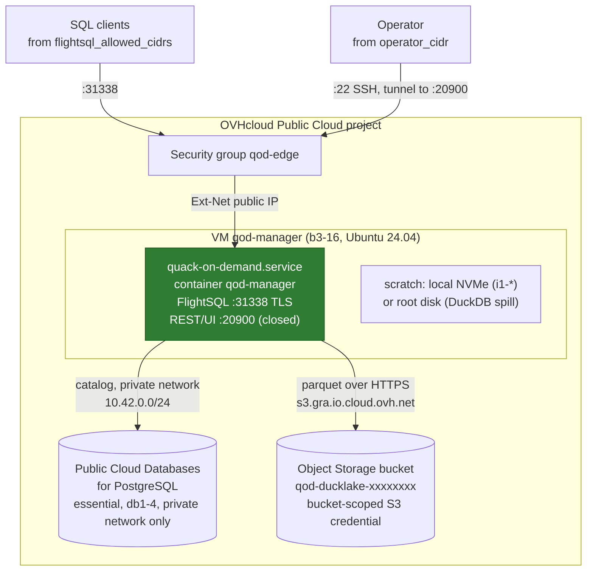
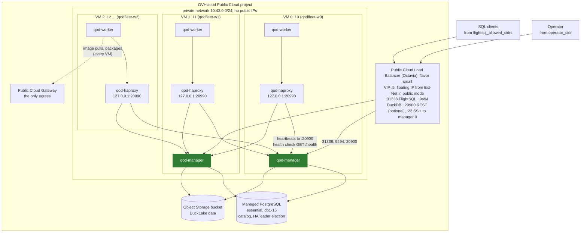

Audience: platform engineer who deploys QoD into their own OVHcloud Public Cloud project.
Scenario: one `terraform apply` that builds either a single QoD VM, or a fleet of VMs with two or more managers behind a load balancer, with the catalog in OVH managed PostgreSQL and the DuckLake data in OVH Object Storage.

The OVHcloud stacks come in two shapes:

- **Single node**: one VM runs the QoD manager and spawns its DuckDB nodes locally (the local runtime of [Single-server production deployment](./deploy-single-server.md)).
- **Fleet**: `worker_count` VMs each run one fleet worker (one query node), and the first `manager_count` of them also run a manager, active-active (the runtime of [Fleet deployment](./deploy-fleet.md)).

Both run the pinned `starlakeai/quack-on-demand` Docker image under systemd, on the host network. There is no Kubernetes. The Terraform lives in the `starlake-ai/qod-deployment` repository, folder [`terraform/ovhcloud/`](https://github.com/starlake-ai/qod-deployment/tree/main/terraform/ovhcloud): `single-node/` and `fleet/` are the two stacks, `modules/` holds the provider modules they share.

## Architecture

### Single node

The default setup is `ducklake_storage = "s3"`, `postgres_mode = "managed"`, `network_mode = "public"`:



With the default setup the VM holds no durable state. The DuckLake catalogs and the control plane live in the managed PostgreSQL cluster, which has no public endpoint. The parquet data lives in the bucket. Local NVMe, when the flavor has it, is spill space only.

Three variables change the setup:

| Variable | Value | What it changes on OVHcloud |
|---|---|---|
| `ducklake_storage` | `s3` (default) | An OVH Object Storage bucket `<name_prefix>-ducklake-<8 hex>` in `s3_region`, versioning off, reached at `https://s3.<s3_region>.io.cloud.ovh.net` with a dedicated S3 credential whose policy covers only that bucket. QoD's default data path is `s3://<bucket>/qod`. |
| | `local` | No bucket. A persistent Block Storage volume (`data_volume_size_gb`, default 100 GB, type `data_volume_type`, default `classic`) is attached and mounted at `/srv/qod-data` (ext4). The default data path is `/srv/qod-data/ducklake/qod`. |
| `postgres_mode` | `managed` (default) | An OVH Public Cloud Databases for PostgreSQL cluster on the private network only. QoD connects as the cluster admin `avnadmin`. |
| | `local` | A `postgres:16.16` container (unit `qod-postgres`) listening on `127.0.0.1:5432` only, its data under `/srv/qod-data/postgres` on the same Block Storage volume. |
| `network_mode` | `public` (default) | The VM gets an Ext-Net public IP (directly routed, no floating IP), its only egress, plus a NIC on the private network for PostgreSQL. |
| | `private` | The VM has only the private NIC. An OVH Public Cloud Gateway (`gateway_model`, default `s`) gives it SNAT egress. You reach it from the vRack, a VPN or a bastion of your own. The stack creates no bastion. |

Either local mode creates the Block Storage volume. Cloud-init formats it only when it carries no filesystem, so a replaced VM mounts the previous VM's data untouched. `terraform destroy` deletes it.

What the single-node stack creates (names use `name_prefix`, default `qod`):

| Module | Resources and defaults |
|---|---|
| `network` | Private network `qod-private` (vRack VLAN `142`), subnet `qod-subnet` `10.42.0.0/24` with DHCP. In private mode, also the Public Cloud Gateway `qod-gateway`. |
| `security` | Security group `qod-edge`, default rules deleted: ingress is only what the stack adds (see [Network and security](#network-and-security)), egress open. |
| `postgres` (managed only) | Cluster `qod-catalog`: plan `essential` (one node, no HA), flavor `db1-4`, PostgreSQL `16`, `db_deletion_protection = true`, create timeout 40 min. The `avnadmin` password is reset at create. Database `qod` for the control plane. No connection pool. |
| `s3` (s3 only) | The bucket, a Public Cloud user with role `objectstore_operator`, its S3 credential and a bucket-scoped S3 policy. |
| `volume` (either local mode) | Block Storage volume `qod-data`. |
| `instance` | VM `qod-manager`: flavor `b3-16` (4 vCPU, 16 GB, no local NVMe), image `Ubuntu 24.04`, key pair `qod-key`. In private mode the user data rides a config drive. |

Two OVH specifics are handled at boot. API-created PostgreSQL users cannot be granted CREATEDB, and QoD creates one database per tenant database, so QoD uses `avnadmin`. OVH clusters ship only `defaultdb`, so the `qod-ensure-admin-db` step of the unit creates the `postgres` maintenance database QoD creates tenant databases from.

The default `b3-16` flavor puts DuckDB spill on the root disk, which is fine for evaluation. For analytics, choose an `i1-*` flavor (`instance_flavor = "i1-45"` in the example tfvars): cloud-init mounts its local NVMe disks (RAID0 when there are several) at `/mnt/nvme` for spill.

### Fleet



Every VM runs three containers under systemd:

| Container (unit) | On | Role |
|---|---|---|
| `qod-manager` (`quack-on-demand`) | The first `manager_count` VMs | A manager replica with `QOD_RUNTIME_TYPE=fleet` and `QOD_HA_ENABLED=true`; leadership is elected through PostgreSQL. Its own `QOD_INTERNAL_URL` is `http://<its ip>:20901`, for node callbacks. |
| `qod-worker` (`qod-worker`) | Every VM | `qod fleet join` in the same image: one query node on port `21900`, named `qodfleet-w<i>`. |
| `qod-haproxy` (`qod-haproxy`) | Every VM | HAProxy `haproxy:3.0.31` on `127.0.0.1:20990`, balancing over every manager's port `20900`, health-checked on `GET /health` every 2 s. The worker heartbeats to it, so it keeps a live manager when one dies. |

Defaults:

| Variable | Default | Notes |
|---|---|---|
| `worker_count` | `3` | 2 to 90. Every VM runs a worker. |
| `manager_count` | `2` | At least 2, at most `worker_count` (a plan-time precondition). |
| `instance_flavor` | `b3-16` | Every VM. `i1-*` adds local NVMe spill. |
| `db_plan` / `db_flavor` | `essential` / `db1-15` | About 375 connections (OVH allows about 100 per 4 GB). `db1-4` is too small for a fleet. |
| `lb_flavor` | `small` | Octavia flavor (`small`, `medium`, `large`, `xl`). |
| `network_mode` | `public` | `public`: a floating IP on the load balancer. `private`: the private VIP only. The VMs never have public IPs. |
| `duckdb_memory_fraction` | `0.5` | Node `memory_limit` as a share of VM RAM (`0.6` on the single node). Manager VMs share their RAM with a node and the manager JVM. |
| `name_prefix` / `vlan_id` / `private_network_cidr` | `qodfleet` / `143` / `10.43.0.0/24` | Differ from the single node (`qod` / `142` / `10.42.0.0/24`) so both stacks fit in one project. |

The fleet always uses managed PostgreSQL and Object Storage: a node can land on any VM, so the data path must be an object-store URL. The managers' default data path is `s3://<bucket>/qod`.

**Credentials on workers.** A worker's only secret is the join token, in `/etc/qod/worker.env` (root, mode 600). It holds no PostgreSQL or storage credential: the manager sends those in each node assignment. Only servers whose heartbeat comes from the private subnet are approved on join (`QOD_FLEET_AUTO_APPROVE=<private_network_cidr>`, see [Join approval](./deploy-fleet.md#join-approval)).

**Fixed addresses.** VM `i` is host `10 + i` of the subnet (`10.43.0.10`, `10.43.0.11`, ...), the load balancer VIP is host `5`, and DHCP hands out `.100` and up (gateway, database nodes, load balancer ports). Hence a `/24` or larger subnet and at most 90 VMs. The rendered cloud-init of each VM embeds its own address and the manager addresses, so an address never moves.

**Load balancer.** One L4 TCP Octavia load balancer, `LEAST_CONNECTIONS`, with a 1 hour idle timeout on client and member data so long FlightSQL and DuckDB sessions are not cut at Octavia's 50 s default. The FlightSQL, DuckDB and REST pools are the manager VMs, health-checked with `GET /health` on port 20900. The SSH pool is manager 0 only, with a TCP check.

### Network and security

| Port | Service | Single node | Fleet |
|---|---|---|---|
| 31338 | FlightSQL, TLS | Security group rule per CIDR in `flightsql_allowed_cidrs`. Empty by default: closed. | Load balancer listener with `allowed_cidrs = flightsql_allowed_cidrs`. No listener at all while the list is empty. |
| 9494 | DuckDB quack front door | Not opened. | Load balancer listener, same CIDRs as 31338 (`duckdb_endpoint` output). |
| 20900 | REST API and admin UI | Closed. `rest_ui_public = true` opens it to `operator_cidr`. Otherwise an SSH tunnel. | Listener only with `rest_ui_public = true`, limited to `operator_cidr`. Otherwise an SSH tunnel to manager 0. Also the heartbeat and health-check port inside the subnet. |
| 22 | SSH | `operator_cidr`. | Load balancer listener to manager 0, limited to `operator_cidr`. VM to VM inside the subnet for `ssh -J`. |
| 20901 | Node verdict callbacks (HA) | Not opened. | Private subnet only. |
| 21900 | Fleet node | Not opened. | Private subnet only: manager to node. |
| 5432 | PostgreSQL | Local mode: `127.0.0.1:5432` only. Managed mode: the cluster's own port (OVH allocates it per cluster, not 5432), private network only. | Managed cluster port, private network only. |

**Where filtering happens.** On the single node, the security group `qod-edge` filters client addresses directly. On the fleet, the Octavia amphora does not preserve client addresses, so the VMs only ever see traffic from the private subnet. The fleet security group `qodfleet-fleet` therefore admits only the subnet, on ports 22, 9494, 20900, 20901, 21900 and 31338, and client filtering happens on each listener's `allowed_cidrs`. An Octavia listener with an empty `allowed_cidrs` admits everyone, which is why the stack creates no client listener until you list a range.

**SSH path.** Single node, public mode: `ssh ubuntu@<manager_public_ip>`. Single node, private mode: from a host that reaches the private network, `ssh ubuntu@<manager_private_ip>`. Fleet: `ssh ubuntu@<lb_address>` lands on manager 0; every other VM is `ssh -J ubuntu@<lb_address> ubuntu@<ip>`. If manager 0 is down, the load balancer has no SSH path to the fleet.

**Secrets.** No secret is a Terraform output. The manager settings, including `QOD_ADMIN_PASSWORD`, `QOD_PG_PASSWORD` and the `QOD_S3_*` keys, live in `/etc/quack-on-demand.env` (root, mode 600), written with a quoted heredoc so no value is shell-expanded. The fleet join token is also in `/etc/qod/worker.env` on every VM, and the local PostgreSQL password in `/etc/qod-postgres.env`. Docker hands the values to the containers with `--env-file`. They do sit in the Terraform state, so protect the state file. A preflight step refuses to start the manager when the admin password is shorter than 12 characters or a default-like value.

**Instance metadata.** OpenStack user data, which carries these secrets, can be re-read from `http://169.254.169.254` by any local process. Cloud-init first installs an nftables rule that drops traffic to `169.254.169.254` from every non-root uid, which covers the containers too since they run as uid 1000 on the host network. Fleet VMs and private-mode single nodes read their user data from a config drive instead of the metadata service. Docker runs with `"bridge": "none"` and `"iptables": false`, so no container port is published around the host filter.

**Plain HTTP inside the fleet.** Workers reach the managers over `http://127.0.0.1:20990` with `QOD_FLEET_INSECURE=true`, so heartbeats and the assignments that carry database and storage credentials cross the private subnet unencrypted. The subnet holds only the fleet VMs, the load balancer, the gateway and the database. [Fleet deployment](./deploy-fleet.md#secure-in-production) recommends HTTPS for production; weigh that before you put other machines on this network.

See also [Hardening](./hardening.md), [TLS](./tls.md) and [Authenticating](../connecting/authenticating.md).

## How to

### Prerequisites

- **Terraform 1.7 or later** (`required_version = ">= 1.7"`), with the providers `ovh/ovh ~> 2.0`, `terraform-provider-openstack/openstack ~> 3.0` and `hashicorp/random ~> 3.0`. `terraform init` installs them from the committed lock file.
- **An OVHcloud Public Cloud project.** `service_name` is its 32-character hex id (Control Panel, Public Cloud, project id), not its display name. The private networks are vRack VLANs (142 and 143), so the project must be able to create private networks.
- **OVH API credentials in the environment**, never in tfvars: `OVH_ENDPOINT`, `OVH_APPLICATION_KEY`, `OVH_APPLICATION_SECRET`, `OVH_CONSUMER_KEY` (or `OVH_ENDPOINT` plus `OVH_ACCESS_TOKEN`).
- **OpenStack credentials in the environment**: the OpenRC file of a Public Cloud OpenStack user (`source openrc.sh`, which sets `OS_AUTH_URL`, `OS_USERNAME`, `OS_PASSWORD`, `OS_TENANT_ID` or `OS_PROJECT_ID`, `OS_REGION_NAME`).
- **A region with the services you need.** Defaults: `region = "GRA11"` for compute, network, load balancer and database, `s3_region = "gra"` for Object Storage. Keep both in the same location. `data_volume_type` availability depends on the region.
- **On your workstation**: an SSH key pair, `jq` for the fleet checks, and the `qod` CLI (`uv tool install qod`) for the first-use steps. No OVH CLI is needed.

### Deploy a single node

1. Get the code and enter the stack:

   ```bash
   git clone https://github.com/starlake-ai/qod-deployment.git
   cd qod-deployment/terraform/ovhcloud/single-node
   cp terraform.tfvars.example terraform.tfvars
   ```

2. Edit `terraform.tfvars`. The required variables, with the three setup options commented at their defaults:

   ```hcl
   service_name            = "xxxxxxxxxxxxxxxxxxxxxxxxxxxxxxxx"  # Public Cloud project id
   operator_cidr           = "203.0.113.4/32"                    # your workstation, for SSH
   flightsql_allowed_cidrs = ["203.0.113.4/32"]                  # empty list = FlightSQL closed
   ssh_public_key          = "ssh-ed25519 AAAA... you@host"
   admin_password          = "change-me-to-a-real-passphrase"    # >= 12 chars, never "admin"

   # ducklake_storage    = "s3"       # or "local": Block Storage volume at /srv/qod-data
   # postgres_mode       = "managed"  # or "local": PostgreSQL container on the VM, 127.0.0.1 only
   # network_mode        = "public"   # or "private": no public IP, egress through a Public Cloud Gateway
   # data_volume_size_gb = 100        # created when either local mode is used
   # rest_ui_public      = false      # true opens 20900 to operator_cidr
   ```

   `*.tfvars` is git-ignored in the repository; keep it that way, it holds the admin password.

3. Load the credentials and apply. Managed PostgreSQL is the long pole of the apply.

   ```bash
   source openrc.sh
   export OVH_ENDPOINT=... OVH_APPLICATION_KEY=... OVH_APPLICATION_SECRET=... OVH_CONSUMER_KEY=...
   terraform init
   terraform apply
   ```

4. Wait for cloud-init and check the service:

   ```bash
   IP=$(terraform output -raw manager_public_ip)    # network_mode = "private": manager_private_ip
   ssh ubuntu@"$IP" 'sudo cloud-init status --wait && systemctl is-active quack-on-demand'
   ssh ubuntu@"$IP" 'curl -s http://127.0.0.1:20900/health; curl -s http://127.0.0.1:20900/ready'
   ```

   The container image has no curl; the host has it. `terraform output -raw flightsql_endpoint` prints `<host>:31338`, and `terraform output rest_ui_tunnel` prints the SSH tunnel command for the REST/UI. Then follow [First use](#first-use).

### Deploy a fleet

1. Enter the stack and create the tfvars:

   ```bash
   cd qod-deployment/terraform/ovhcloud/fleet
   cp terraform.tfvars.example terraform.tfvars
   ```

2. Edit `terraform.tfvars`:

   ```hcl
   service_name            = "xxxxxxxxxxxxxxxxxxxxxxxxxxxxxxxx"
   operator_cidr           = "203.0.113.4/32"   # SSH to manager 0, and REST with rest_ui_public
   flightsql_allowed_cidrs = ["203.0.113.4/32"] # 31338 and 9494; empty = no client listener
   ssh_public_key          = "ssh-ed25519 AAAA... you@host"
   admin_password          = "change-me-to-a-real-passphrase"

   # worker_count    = 3         # VMs; every VM runs a fleet worker
   # manager_count   = 2         # >= 2, <= worker_count; managers on the first VMs
   # network_mode    = "public"  # "private": the load balancer keeps only its private VIP
   # instance_flavor = "b3-16"   # i1-* for local NVMe spill
   # db_flavor       = "db1-15"  # db1-4 is too small for a fleet
   ```

3. Apply with the same environment as the single node:

   ```bash
   terraform init
   terraform apply
   ```

4. Wait for every VM through the load balancer's SSH listener (manager 0) and jumps from there:

   ```bash
   LB=$(terraform output -raw lb_address)
   ssh ubuntu@"$LB" 'sudo cloud-init status --wait'                   # manager 0
   for ip in $(terraform output -json worker_ips | jq -r '.[]'); do   # every VM
     ssh -J ubuntu@"$LB" ubuntu@"$ip" 'sudo cloud-init status --wait && systemctl is-active qod-haproxy qod-worker'
   done
   ```

   `terraform output manager_ips` lists the manager VMs. In private mode, run this from a host that reaches the private network.

5. Check the fleet from inside a manager container. The fleet commands are superuser-only.

   ```bash
   ssh -t ubuntu@"$LB" sudo docker exec -it qod-manager qod login --url http://127.0.0.1:20900   # user admin
   ssh -t ubuntu@"$LB" sudo docker exec -it qod-manager qod fleet servers
   ```

   Every VM should appear as `qodfleet-w<i>`, `reachable` and `approved`. Clients use `terraform output -raw flightsql_endpoint` (TLS, self-signed by default) or `terraform output -raw duckdb_endpoint` (`quack:<lb_address>:9494`). Then follow [First use](#first-use), running the container commands on manager 0.

### First use

A fresh install has no tenant: FlightSQL refuses with `missing tenant scope ... 'tenant' header required` until a tenant, a database and a pool exist. Authentication is the admin user (`admin`, or `admin@localhost.local`) with the `admin_password` from your tfvars. For automation, create a personal access token with `qod auth pat create` after logging in.

1. On the VM (on the fleet: manager 0), inside the manager container, which runs the same `qod` version as the server:

   ```bash
   sudo docker exec -it qod-manager qod login --url http://127.0.0.1:20900          # user admin, password = admin_password
   sudo docker exec -it qod-manager qod tenant create acme --display-name Acme
   sudo docker exec -it qod-manager qod database create --tenant acme --name lake   # -> database acme_lake
   sudo docker exec -it qod-manager qod pool create --tenant acme --db acme_lake --pool bi --size 1 --dual 1
   ```

   `--display-name` is required on `tenant create` in 0.14.2. Where the data lands:

   | Setup | Default data path in the env file | Data of `acme_lake` |
   |---|---|---|
   | `ducklake_storage = "local"` | `/srv/qod-data/ducklake/qod` | `/srv/qod-data/ducklake/acme_lake` on the Block Storage volume |
   | `ducklake_storage = "s3"`, and every fleet | `s3://<bucket>/qod` | Expected under `s3://<bucket>/acme_lake` (`terraform output -raw ducklake_bucket`); not yet observed on OVHcloud |

2. From your workstation, log in to the REST API and query over FlightSQL. The REST port must be reachable: either `rest_ui_public = true`, or an SSH tunnel. Forwarding 31338 in the same tunnel keeps FlightSQL working if the edge address `qod login` stores is `localhost`.

   ```bash
   ssh -f -N -L 20900:localhost:20900 -L 31338:localhost:31338 ubuntu@"$IP"   # fleet: ubuntu@"$LB"
   qod login --url http://localhost:20900
   qod sql --tenant acme --pool bi --superuser "SELECT 42"
   ```

   `qod sql` asks for the SQL password, or reads `QOD_PASSWORD`. The certificate is self-signed unless `tls_mode = "provided"` (then set `tls_cert_pem` and `tls_key_pem`); other clients must skip verification against a self-signed edge. See [Clients](../connecting/clients.md), [Tenants and databases](./tenants-databases.md) and [Pools and cohorts](./pools-cohorts.md).

### Operate

**Logs.** QoD itself, then the unit (preflight, database wait, `postgres` database creation, image pull):

```bash
sudo journalctl CONTAINER_NAME=qod-manager -f
```

```bash
sudo journalctl -u quack-on-demand
```

On a local-PostgreSQL single node, `sudo journalctl CONTAINER_NAME=qod-postgres`. On fleet VMs, the same pattern for `CONTAINER_NAME=qod-worker` and `CONTAINER_NAME=qod-haproxy`, and `journalctl -u qod-worker` and `journalctl -u qod-haproxy` for the units.

**Upgrade in place (single node).** Set `QOD_VERSION=<new>` in `/etc/quack-on-demand.env`, then `sudo systemctl restart quack-on-demand`; the unit pulls the new tag once. Set the same `qod_version` in `terraform.tfvars` too: a later rebuild runs whatever tag Terraform renders into cloud-init. Changing `qod_version` there changes the user data and replaces the VM on the next `terraform apply`. Read [Upgrading](../upgrading/to-0-11.md) before a version jump.

**Rolling upgrade (fleet).** Managers one at a time first, then the other VMs: set `QOD_VERSION=<new>` in `/etc/quack-on-demand.env` (managers) and in `/etc/qod/worker.env` (every VM), then `sudo systemctl restart quack-on-demand` and `sudo systemctl restart qod-worker`. Set the same `qod_version` in `terraform.tfvars`, or a later replacement brings back the old tag. Changing it there changes every VM's cloud-init: the next `terraform apply` replaces all VMs, managers included, in one go.

**Rebuild (single node).**

```bash
terraform apply -replace=module.instance.openstack_compute_instance_v2.qod
```

The public IP changes (Ext-Net addresses are not stable across rebuilds; use the Terraform output or DNS). In local modes the Block Storage volume is reattached as is. In the default setup there is nothing on the VM to keep. On the fleet, one VM is `module.vms.openstack_compute_instance_v2.vm[<i>]`.

**Scale the fleet.** Raising `worker_count` adds VMs, which join on boot. Lowering it destroys the highest-numbered VMs without draining them: their nodes stop with them and the managers reassign what they hosted. To move nodes off cleanly first, run `qod fleet drain qodfleet-w<i>` for each VM that will go, then lower `worker_count`, then `qod fleet remove qodfleet-w<i>` (see [Operate the fleet](./deploy-fleet.md#operate-the-fleet)). Changing `manager_count` changes every VM's HAProxy backend list, hence every VM's cloud-init: it replaces all VMs.

**Backups.** In the default setup the catalog is in managed PostgreSQL and the data in Object Storage; the VM holds no state. In either local mode nothing backs the Block Storage volume up: snapshot it yourself.

### Tear down

1. The managed PostgreSQL cluster has deletion protection on by default, so `terraform destroy` refuses it. Set `db_deletion_protection = false`, run `terraform apply`, then `terraform destroy`.
2. The bucket is created without any force-destroy option. Whether OVH refuses to delete a non-empty bucket has not been checked against a real account; if `destroy` fails on it, empty the bucket and run `destroy` again.
3. The Block Storage volume (local modes) is destroyed with no snapshot. Take one first if you need the data.

### Status

As of QoD 0.14.2, both OVHcloud stacks are tested with mocks only.

| Check | Single node | Fleet |
|---|---|---|
| `terraform validate` | Passes | Passes |
| `terraform test` against mock providers | 11 runs pass (setup options, input guards) | 11 runs pass (fleet shape, listeners, private mode, size guards, input guards) |
| Rendered cloud-init through `bash -n` and shellcheck | Not reported | Passes for a manager VM and a worker-only VM |
| Real `terraform apply` on OVHcloud | Not run | Not run |

Not yet proven by a real apply:

- Single node: the Block Storage device discovery, the private-mode gateway and config drive, the Docker daemon settings, the `avnadmin` password reset and the creation of the `postgres` database.
- Fleet: Octavia `allowed_cidrs` on OVH, the floating IP on the load balancer VIP through the Public Cloud Gateway's router, the `db1-15` flavor on the `essential` plan, the HA failover of the managers in fleet mode, and the `/health` path of the health checks.

The first-use sequence above was verified end to end on another cloud with the same image (Google Cloud, single node, 2026-11-25). Treat these stacks as ready for a first real apply, not as a validated production deployment.
